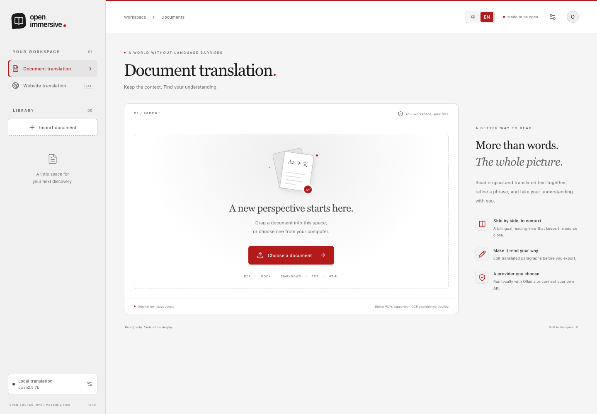

# Open Immersive Translator

**Bilingual websites and documents, using a translation provider you choose.**

An independent, MIT-licensed implementation of paragraph-based website translation and a reflowed document translation workspace. A Chrome extension and a document reader share one local translation backend. The implementation follows the architecture established during a browser-artifact investigation; it contains original code and uses no Immersive Translate service, proprietary source, branding or rule database.



## What works

- **Websites:** translate prose into a bilingual view, retain the original page, restore it, and handle newly inserted content.
- **Interface:** switch between Chinese and English with the **中 / EN** control. Your choice is saved separately from the document translation language. [中文界面预览](docs/images/workspace-zh.png).
- **Documents:** import text PDFs, DOCX, HTML, Markdown and TXT; translate blocks; edit translations; export bilingual HTML/Markdown or print to PDF.
- **Providers:** local Ollama or a configured compatible chat-completion endpoint. Provider credentials stay in the backend environment.
- **Shared core:** protected code/math/link tokens, identified results, bounded requests, caching and explicit per-segment failures.
- **Optional recognition:** use a Docling worker for harder PDFs. The default lightweight PDF parser reads existing text; it does not perform OCR.

This first version produces reflowed documents. It does not preserve the original PDF coordinates or guarantee scientific table/formula recognition. Parser and translation quality depend on the chosen engines. See [architecture and limits](docs/architecture.md).

## Quick start

Requirements: Node.js **22.22.2+**, npm, and a running translation provider.

```sh
git clone https://github.com/Syndr0/open-immersive-translator.git
cd open-immersive-translator
npm ci
cp .env.example .env
```

For local translation, install [Ollama](https://ollama.com/), then:

```sh
ollama pull qwen2.5:7b
npm run dev
```

Open **http://127.0.0.1:5173** for the document workspace. The API listens on **http://127.0.0.1:8787**. Choose a target language, import a file and select Translate. A model must be installed and running for actual translation; there is no silent mock fallback.

For a single-server build:

```sh
npm run build
npm start
```

Open **http://127.0.0.1:8787**. Keep the repository dependencies installed: the API runs TypeScript through `tsx`.

### Use another provider

Set these values in `.env`, then restart the backend:

```dotenv
TRANSLATION_PROVIDER=compatible
COMPATIBLE_BASE_URL=http://127.0.0.1:1234/v1
COMPATIBLE_MODEL=your-model
COMPATIBLE_API_KEY=
```

The compatible adapter sends chat-completion requests and expects JSON containing identified translations. Configure a model that can reliably follow structured instructions. The API key is optional for local servers and required when your chosen provider requires one. Only send documents/page text to a provider you intend to use.

### Install the Chrome extension

1. Run `npm run build` and keep the API running.
2. Open `chrome://extensions`, enable **Developer mode**, and select **Load unpacked**.
3. Choose this repository's **`apps/extension/dist`** folder.
4. Open a normal website, select the extension, choose a language and translate.
5. Use Restore to remove the bilingual additions. Extension settings select the local API address. When using `npm start`, set the Document app URL to `http://127.0.0.1:8787`; its development default is `http://localhost:5173`.

The extension acts on pages you invoke it on. Browser-internal pages, inaccessible frames, shadow-root content and canvas/image-only text require further integrations. Website text is sent to your configured backend/provider when you translate.

### Optional Docling parser

The Python worker is optional and separate from the Node installation. Follow the [Docling worker setup](workers/docling/README.md), set `PARSER=docling` and point `DOCLING_PYTHON` at that environment's Python. See [document parsing](docs/architecture.md#document-parsing). Model downloads may be needed on the first run. Code and model licenses are separate; select and pin the models for your deployment.

## Develop and verify

```sh
npm run verify                 # TypeScript, unit/integration tests, app/extension builds
npx playwright install chromium
npm run test:e2e               # browser workflow with an explicit test provider
```

Tests use an explicitly selected deterministic demo/fake provider. Demo output is labeled and is not evidence of machine-translation quality. Production defaults to Ollama. Review real translations with your selected model before relying on them.

```text
apps/reader       React document workspace
apps/extension    Manifest V3 Chrome extension
services/api      Local upload, parse, job, edit and export API
packages/core     Shared broker, provider adapters and cache
workers           Optional document recognition adapter
tests             Browser integration tests
```

Runtime documents, translation caches and credentials are ignored by Git. Do not commit `.env`, `.data`, personal documents or provider keys. The local API is designed for a single-user loopback deployment; adding remote hosting needs authentication and per-user isolation.

## Design background

The important discovery was the separation between recognition, translation and rendering:

```text
Website DOM ────────────────┐
                           ├─ protected segments → shared broker → provider
Document → parser → blocks ┘                           ↓
                                 bilingual DOM / document → export
```

The source product's PDF Pro client consumes Mathpix Markdown and prints a reflowed HTML view. This project uses replaceable parsing and independent interfaces rather than calling its private endpoints. Coordinate-preserving PDF output, sophisticated table/figure recovery and broad per-site rules remain future work.

See [architecture](docs/architecture.md), [contributing](CONTRIBUTING.md), and [license](LICENSE). This project is not affiliated with Immersive Translate or Mathpix.
